<div align="center">
  
</div>

<p align="center">
  
</p>

<div align="center">
  <a href="https://instagram.com/nur_kalygulovn"></a>
  <a href="https://wa.me/996220709230"></a>
  <a href="mailto:kalygulovnur@gmail.com"></a>
</div>

<div align="center">
  <a href="https://kalygulovdonat-ctrl.github.io/portfolio-3d/"></a>
  <a href="https://github.com/kalygulovdonat-ctrl?tab=repositories"></a>
  
</div>

---

### 🐍 Contribution Activity

<picture>
  <source media="(prefers-color-scheme: dark)" srcset="https://raw.githubusercontent.com/kalygulovdonat-ctrl/kalygulovdonat-ctrl/output/snake-dark.svg" />
  <source media="(prefers-color-scheme: light)" srcset="https://raw.githubusercontent.com/kalygulovdonat-ctrl/kalygulovdonat-ctrl/output/snake.svg" />
  
</picture>

---

### `$ cat ./me.ts`

```ts
const developer = {
  role:     "Full Stack Developer",
  stack:    { back: ["Python", "Django", "DRF"], front: ["React", "TypeScript", "Three.js"] },
  builds:   ["3D-сайты для бизнеса", "веб-приложения", "админ-панели", "лендинги"],
  workflow: ["idea", "design", "code", "deploy", "repeat"],
  location: "Bishkek, KG 🇰🇬",
  motto:    "Сайт должен не просто работать — он должен впечатлять.",
} as const;
```

---

### 🚀 Featured Projects

<table>
  <tr>
    <td width="50%" valign="top">
      <p>
        <a href="https://github.com/kalygulovdonat-ctrl/lifeos"><b>🧠 LifeOS — Personal Life OS</b></a><br/>
        
      </p>
      <p>Система управления жизнью: задачи, привычки, цели и заметки в одном месте. Full stack приложение с REST API и SPA-фронтендом.</p>
      <p>
        
        
        
      </p>
      <a href="https://github.com/kalygulovdonat-ctrl/lifeos"></a>
    </td>
    <td width="50%" valign="top">
      <p>
        <a href="https://github.com/kalygulovdonat-ctrl/portfolio-3d"><b>🎨 Portfolio 3D</b></a><br/>
        
      </p>
      <p>Интерактивное 3D-портфолио: сцена на WebGL, анимации при скролле и плавные переходы между разделами.</p>
      <p>
        
        
        
      </p>
      <a href="https://kalygulovdonat-ctrl.github.io/portfolio-3d/"></a>
      <a href="https://github.com/kalygulovdonat-ctrl/portfolio-3d"></a>
    </td>
  </tr>
  <tr>
    <td width="50%" valign="top">
      <p>
        <a href="https://github.com/kalygulovdonat-ctrl/shop-3d"><b>🛍 Shop 3D</b></a><br/>
        
      </p>
      <p>Интернет-магазин с 3D-витриной товаров — покупатель крутит продукт прямо в браузере.</p>
      <p>
        
        
      </p>
      <a href="https://kalygulovdonat-ctrl.github.io/shop-3d/"></a>
      <a href="https://github.com/kalygulovdonat-ctrl/shop-3d"></a>
    </td>
    <td width="50%" valign="top">
      <p>
        <a href="https://github.com/kalygulovdonat-ctrl/bishkek-clothes-demos"><b>👕 Bishkek Clothes Demos</b></a><br/>
        
      </p>
      <p>Демо-концепты сайтов для магазинов одежды Бишкека с админкой для управления товарами.</p>
      <p>
        
        
      </p>
      <a href="https://github.com/kalygulovdonat-ctrl/bishkek-clothes-demos"></a>
    </td>
  </tr>
</table>

<details>
<summary><b>🌐 Ещё 3D-сайты / More 3D sites — нажми, чтобы открыть</b></summary>
<br/>

| Проект | Что это | Демо |
|:--|:--|:--:|
| ☕ [coffee-3d](https://github.com/kalygulovdonat-ctrl/coffee-3d) | 3D-сайт кофейни | [▶ Live](https://kalygulovdonat-ctrl.github.io/coffee-3d/) |
| ⌚ [watch-3d](https://github.com/kalygulovdonat-ctrl/watch-3d) | 3D-витрина часов | [▶ Live](https://kalygulovdonat-ctrl.github.io/watch-3d/) |
| 🏠 [dom-3d](https://github.com/kalygulovdonat-ctrl/dom-3d) | Недвижимость в 3D | [▶ Live](https://kalygulovdonat-ctrl.github.io/dom-3d/) |
| 🚗 [autoschool-3d](https://github.com/kalygulovdonat-ctrl/autoschool-3d) | Сайт автошколы | [▶ Live](https://kalygulovdonat-ctrl.github.io/autoschool-3d/) |
| 🏔 [trek-3d](https://github.com/kalygulovdonat-ctrl/trek-3d) | Походы и туры | [▶ Live](https://kalygulovdonat-ctrl.github.io/trek-3d/) |
| 🖼 [gallery-3d](https://github.com/kalygulovdonat-ctrl/gallery-3d) | 3D-галерея | [▶ Live](https://kalygulovdonat-ctrl.github.io/gallery-3d/) |
| 🎉 [fest-3d](https://github.com/kalygulovdonat-ctrl/fest-3d) | Сайт фестиваля | [▶ Live](https://kalygulovdonat-ctrl.github.io/fest-3d/) |
| 💧 [drop-3d](https://github.com/kalygulovdonat-ctrl/drop-3d) | 3D-лендинг | [▶ Live](https://kalygulovdonat-ctrl.github.io/drop-3d/) |
| 🛞 [bishkek-tire-demos](https://github.com/kalygulovdonat-ctrl/bishkek-tire-demos) | Демо шинных магазинов | [▶ Live](https://kalygulovdonat-ctrl.github.io/bishkek-tire-demos/) |

</details>

---

### 🛠 Tech Stack

<div align="center">

| Область | Технологии |
| :--- | :--- |
| **Languages** |      |
| **Frontend** |     |
| **Backend** |    |
| **Tools & Deploy** |     |

</div>

---

### 📊 Live GitHub Telemetry

<div align="center">
  
</div>

---

<div align="center">
  <sub><b>"Не просто сайт — опыт, который хочется открыть ещё раз."</b></sub>
</div>
